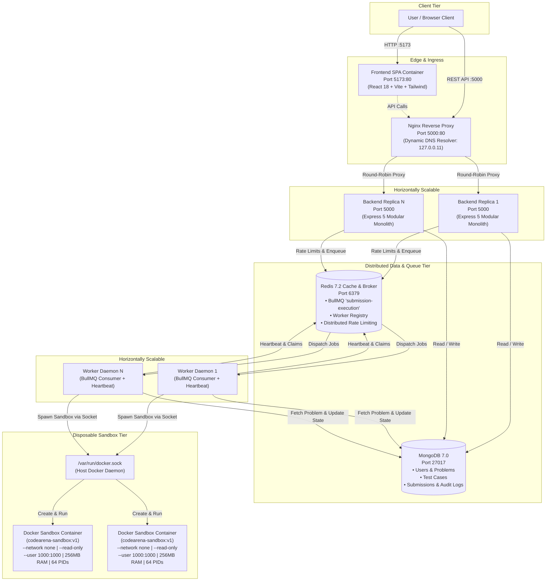
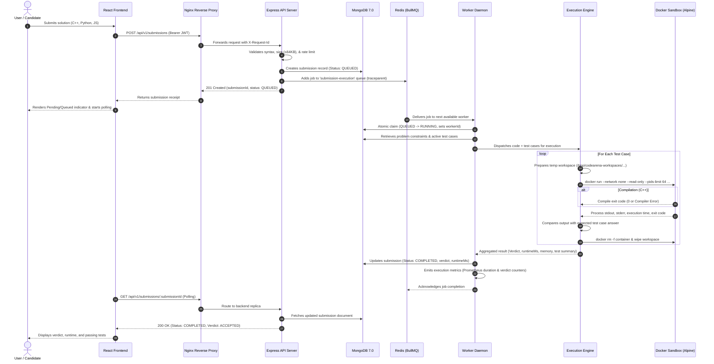

# CodeArena

> **Enterprise-Grade Distributed Online Judge & Secure Code Execution Platform**

[](https://nodejs.org/)
[](https://expressjs.com/)
[](https://react.dev/)
[](https://www.docker.com/)
[](https://redis.io/)
[](https://www.mongodb.com/)
[](https://nginx.org/)
[](LICENSE)

---

## Overview

**CodeArena** is a full-stack, distributed online judge system engineered to evaluate user-submitted algorithms securely, concurrently, and asynchronously across isolated sandbox containers.

### The Problem It Solves
Evaluating untrusted user code on shared servers poses severe infrastructure and security risks:
- Malicious submissions can launch fork bombs to starve CPU threads.
- Memory leak scripts can trigger host Out-of-Memory (OOM) crashes.
- Arbitrary code execution can exploit network interfaces, access private host files (e.g., `/etc/shadow`), or manipulate system processes.
- Synchronous evaluation blocks web server worker threads, degrading responsiveness under concurrent submission load.

### The Architectural Solution
CodeArena solves these challenges through a distributed, event-driven architecture:
- **Stateless HTTP API Tier**: An Express 5 modular monolith handles client traffic, request validation, authentication, and job queuing. The API layer never mounts the Docker socket and has zero access to host execution environments.
- **Dynamic Load Balancing**: An Nginx reverse proxy routes external traffic across horizontally scalable backend replicas using dynamic Docker DNS resolution (`127.0.0.11 valid=5s`).
- **Decoupled Asynchronous Processing**: Submissions are pushed to a Redis-backed BullMQ queue (`submission-execution`), decoupling ingestion throughput from evaluation compute.
- **Autonomous Worker Fleet**: Independent worker daemons (`submission.worker.js`) consume queue jobs, maintain heartbeats in a distributed Redis registry, and manage execution lifecycles.
- **Disposable Sandbox Containers**: Code is compiled and executed inside hardened, ephemeral Alpine Linux containers (`codearena-sandbox:v1`) equipped with zero network access (`--network none`), a read-only root filesystem, non-root UID execution, dropped kernel capabilities (`--cap-drop ALL`), strict PID limits, and strict CPU/memory caps.

### Intended Users
- **Competitive Programmers & Students**: Solve algorithm problems in C++, Python, and JavaScript with instantaneous, fine-grained verdict feedback.
- **Technical Interviewers & Organizations**: Assess candidate problem-solving skills with hidden test suites and execution profiling.
- **Platform Administrators**: Author problems, manage secret test suites, monitor queue metrics, and track distributed worker fleet health in real time.

---

## Key Features

1. **Multi-Language Sandbox Isolation**
   Executes C++ (GCC 13 / C++17), Python 3.12, and JavaScript (Node.js 20) inside disposable containers with `--network none`, `--read-only` root, `--cap-drop ALL`, `--security-opt no-new-privileges`, 256MB RAM cap, 64 PID fork-bomb limits, and 1.0 CPU quota. Host paths and secrets are scrubbed before returning output.

2. **Decoupled Distributed Worker Fleet**
   Worker daemons run as autonomous processes separate from the HTTP API. Workers can be scaled dynamically via `docker compose up --scale worker=N` to meet peak submission demand without reconfiguring the API layer.

3. **Atomic State Transitions & Safe Claim Recovery**
   Submissions transition through an atomic MongoDB state machine (`QUEUED` $\rightarrow$ `RUNNING` $\rightarrow$ `COMPLETED` / `FAILED`). Workers claim jobs using atomic `findOneAndUpdate` queries. Stale submissions from crashed workers are reclaimed after a 30-second threshold without risking concurrent theft of active runs.

4. **Dynamic Nginx Reverse Proxy & Load Balancing**
   Nginx dynamically discovers scaled backend replicas (`docker compose up --scale backend=N`) using embedded Docker DNS (`resolver 127.0.0.11 valid=5s`), featuring upstream failover, request ID propagation, and gateway health probes.

5. **Distributed Worker Registry & Health Telemetry**
   Workers register ephemeral records in Redis with collision-resistant identifiers (`worker-<hostname>-<pid>-<random>`), sending periodic heartbeats. Admins can inspect active, draining, and stopped workers via `/api/v1/admin/workers`.

6. **Role-Based Access Control (RBAC) & Test Case Secrecy**
   Strict permission boundaries separate unauthenticated guests, authenticated users (`USER`), and platform administrators (`ADMIN`). Hidden test cases used for final verdicts are protected from candidate visibility.

7. **Production Observability & Prometheus Metrics**
   Exposes a native Prometheus scrape endpoint (`GET /metrics`) with true histogram distributions for HTTP latency and execution runtimes. Route paths are normalized into templates (e.g., `/api/v1/problems/:problemId`) to prevent metric cardinality explosion.

8. **End-to-End Distributed Tracing (W3C Trace Context)**
   Adheres to W3C Trace Context standards. Every incoming request receives or generates a `traceparent` header that is propagated through HTTP headers, BullMQ job metadata, and worker logs for end-to-end auditability.

9. **Interactive OpenAPI 3.0.3 Swagger Documentation**
   Complete API specifications are maintained in `openapi.json` and rendered interactively via Swagger UI at `/api/v1/docs` for rapid developer onboarding.

10. **Modern Competitive Programming Web IDE**
    React 18 single-page application built with Vite and Tailwind CSS. Features language-aware code templates, problem search and difficulty filters, responsive multi-pane layout, submission history, and GitHub-style submission activity heatmaps.

---

## Tech Stack

| Category | Technology | Version | Purpose in CodeArena |
| :--- | :--- | :--- | :--- |
| **Core Languages** | JavaScript / Node.js | `20.x LTS` | Runtime environment for API server, worker daemons, and test suites. |
| | C++ | `GCC 13 (C++17)` | Compiled language support in sandbox execution engine. |
| | Python | `3.12` | Interpreted language support in sandbox execution engine. |
| **Backend API** | Express.js | `5.2.1` | High-performance modular monolith REST API foundation. |
| | Helmet | `8.3.0` | Comprehensive HTTP security response headers. |
| | Morgan | `1.12.1` | HTTP request logging with correlation IDs. |
| | Express Rate Limit | `8.7.0` | API abuse prevention on authentication and submission routes. |
| | Rate Limit Redis | `6.0.1` | Distributed sliding-window store for rate limiters. |
| | Swagger UI Dist | `5.33.0` | In-app interactive OpenAPI 3.0 documentation. |
| **Frontend SPA** | React | `18.3.1` | Declarative component UI for problem catalog, IDE, and dashboards. |
| | Vite | `6.1.0` | Next-generation frontend build tooling and HMR dev server. |
| | Tailwind CSS | `3.4.17` | Utility-first styling for dark-mode competitive programming UI. |
| | React Router DOM | `6.28.2` | Client-side routing with role-based navigation guards. |
| | Lucide React | `0.475.0` | Modern SVG iconography. |
| **Datastores & Queues** | MongoDB | `7.0` | Primary document database for users, problems, test cases, and submissions. |
| | Mongoose | `9.10.1` | Schema modeling, validation, and replica-set connection management. |
| | Redis | `7.2-alpine` | In-memory message broker, rate limit store, and worker registry. |
| | BullMQ | `6.3.6` | Distributed task queue with retries, exponential backoff, and concurrency control. |
| | ioredis | `6.0.0` | High-throughput Redis client for queue and worker pub/sub operations. |
| **Execution Engine** | Docker Engine | `24.x+` | Container virtualization for isolated sandbox execution. |
| | Alpine Linux | `3.20` | Minimal, hardened base image for `codearena-sandbox:v1`. |
| **Reverse Proxy** | Nginx | `1.25-alpine` | Reverse proxy and dynamic DNS load balancer. |
| **Security & Auth** | Argon2 | `0.45.1` | Memory-hard, timing-resistant password hashing (`Argon2id`). |
| | JSON Web Tokens | `9.0.3` | Stateless Bearer token authentication. |
| **Testing** | Node.js Test Runner | `node:test` | Built-in test runner for unit and failure-recovery test suites. |
| | Supertest | `7.2.2` | HTTP integration assertions against Express API routes. |

---

## System Architecture

CodeArena separates concerns across four distinct tiers:
1. **Edge / Load Balancer**: Nginx terminates incoming client requests on port `5000` and balances traffic across API containers.
2. **Frontend Tier**: Nginx-served static React 18 SPA accessible on port `5173`.
3. **Application Tier**: Horizontally scalable Express 5 API instances managing business logic and enqueuing evaluation jobs.
4. **Asynchronous Execution Tier**: Scalable BullMQ worker daemons orchestrating ephemeral Docker sandbox containers over the host Docker daemon.



---

## How It Works

### The Submission & Execution Lifecycle



### Detailed Workflow Stages

1. **Ingestion & Validation**:
   The user submits code via the React IDE. The request passes through Nginx to an Express API instance. The API checks the payload against size limits (max 64 KB), validates the language identifier (`CPP`, `PYTHON`, `JAVASCRIPT`), verifies that the targeted problem is active and ready, and checks the user's rate-limit quota.

2. **Persistence & Queue Dispatch**:
   The API writes a new `Submission` document to MongoDB with status `QUEUED`. It extracts or generates a W3C `traceparent` identifier and pushes `{ submissionId }` into the BullMQ queue `submission-execution`. The submission ID is immediately returned to the client.

3. **Atomic Worker Claiming**:
   An autonomous worker daemon dequeues the task. It executes an atomic `findOneAndUpdate` on MongoDB:
   - If the submission is `QUEUED`, it transitions to `RUNNING` with the worker's unique ID and current timestamp.
   - If the submission was `RUNNING` but its timestamp is older than 30 seconds (indicating a crashed worker), it is safely reclaimed.
   - If the submission is already `COMPLETED` or actively held by a healthy peer worker, it is safely skipped.

4. **Isolated Docker Sandbox Execution**:
   The worker invokes the `Execution Engine`. A unique workspace directory is created on the host under `/tmp/codearena-workspaces/<execId>`. The engine invokes `docker run` on the `codearena-sandbox:v1` image using Docker-out-of-Docker:
   - For C++: Compiled using `g++ -O3 -std=c++17` within a 10-second timeout.
   - For Python: Run with `python3 -u main.py`.
   - For JavaScript: Run with `node main.js`.
   Each test case is piped through stdin. If execution exceeds the problem's time limit, memory limit (256MB), or maximum output buffer (512KB), the container process is forcefully killed.

5. **Verdict Evaluation & Persistence**:
   The engine compares sanitized standard output against the expected output, trimming whitespace. Verdicts are computed using standard competitive programming classifications (`ACCEPTED`, `WRONG_ANSWER`, `TIME_LIMIT_EXCEEDED`, `MEMORY_LIMIT_EXCEEDED`, `RUNTIME_ERROR`, `COMPILATION_ERROR`). The worker updates the submission in MongoDB to `COMPLETED` and cleans up the temporary host workspace.

---

## Application Screenshots / Demo

The repository contains real UI screenshots located in the `ui designs/` directory.

### Home & Landing Page
The landing page introduces CodeArena, providing direct navigation to the problem set, platform statistics, and authentication.


---

### User Authentication
Secure authentication flows featuring client-side form validation, Argon2id password hashing, and JWT bearer token issuance.

| Login Page | Registration Page |
| :---: | :---: |
|  |  |

---

### Problem Catalog & Search
Browse problems with multi-parameter filtering by difficulty (`EASY`, `MEDIUM`, `HARD`), tag categorization, search query, and personal completion status.


---

### Interactive Problem Workspace & Code Editor
Multi-pane IDE with problem statement rendering, constraint badges, sample test cases, syntax-highlighted code editor, language selector, and interactive test verdict console.


---

### User Profile & Activity Analytics
User profile displaying overall submission counts, acceptance rates, difficulty breakdowns, solved problem directories, and historical submission activity heatmaps.


---

### Administrative Management Dashboard
Admin portal providing problem lifecycle controls, test case authoring, queue telemetry, and distributed worker fleet monitoring.

| Admin Dashboard Overview | Problem Authoring & Test Suite Configuration |
| :---: | :---: |
|  |  |

---

## Installation & Setup

### Prerequisites
Before running CodeArena, ensure the following tools are installed on your host system:
- **Docker Engine**: `24.0+`
- **Docker Compose**: `v2.20+`
- **Node.js**: `20.x LTS` (for local standalone development)
- **npm**: `10.x+`
- **Git**

---

### Quick Start (Recommended: Docker Compose)

#### 1. Clone the Repository
```bash
git clone https://github.com/saurabh0772/Code-Arena.git
cd Code-Arena
```

#### 2. Configure Environment Variables
Copy the provided template to create your `.env` file:
```bash
cp .env.example .env
```
*(Ensure `JWT_SECRET` contains a secure random string of at least 32 characters in production).*

#### 3. Build the Execution Engine Sandbox Image
The worker daemon executes untrusted code inside this isolated image:
```bash
npm run docker:build-sandbox
# Or directly:
# docker build -t codearena-sandbox:v1 -f execution-engine/Dockerfile.sandbox execution-engine
```

#### 4. Launch the Complete Platform
Start the reverse proxy, frontend, backend API, worker, Redis, and MongoDB in detached mode:
```bash
docker compose up -d --build
```

#### 5. Verify Running Containers
Check that all services are healthy and running:
```bash
docker compose ps
```

#### 6. Seed Initial Problems and Admin Account
Populate the database with curated competitive programming problems and test cases:
```bash
# Run seed script inside the running backend container
docker compose exec backend npm run seed
```

#### 7. Access the Application
- **Frontend SPA**: [http://localhost:5173](http://localhost:5173)
- **Backend API & Swagger Docs**: [http://localhost:5000/api/v1/docs](http://localhost:5000/api/v1/docs)
- **System Health Probe**: [http://localhost:5000/health](http://localhost:5000/health)
- **Reverse Proxy Probe**: [http://localhost:5000/proxy-health](http://localhost:5000/proxy-health)
- **Prometheus Metrics**: [http://localhost:5000/metrics](http://localhost:5000/metrics)

---

### Horizontal Scaling Commands

CodeArena was designed for horizontal scalability. You can scale the backend API and worker tiers independently using Docker Compose:

```bash
# Scale to 2 backend API replicas and 3 worker processes
docker compose up -d --scale backend=2 --scale worker=3

# Inspect dynamic upstream balancing across containers
docker compose logs -f reverse-proxy
```

---

### Standalone Local Development (Without Full Docker Compose)

If you prefer running services directly on the host for rapid development:

1. **Start Datastores (Redis & MongoDB)**:
   ```bash
   docker run -d --name codearena-redis -p 6379:6379 redis:7.2-alpine
   docker run -d --name codearena-mongo -p 27017:27017 mongo:7.0
   ```

2. **Install Dependencies**:
   ```bash
   npm --prefix backend install
   npm --prefix frontend install
   npm --prefix execution-engine install
   ```

3. **Build the Sandbox Image**:
   ```bash
   npm run docker:build-sandbox
   ```

4. **Seed Database**:
   ```bash
   npm run seed
   ```

5. **Start Services in Separate Terminals**:
   ```bash
   # Terminal 1: Backend API (Auto-reloads on changes)
   npm run dev:backend

   # Terminal 2: Worker Daemon
   npm run worker

   # Terminal 3: Frontend SPA Dev Server
   npm run dev:frontend
   ```

---

## Environment Variables

The application is configured using environment variables loaded via `dotenv`. The table below describes all supported variables as declared in `backend/src/config/env.js` and `.env.example`:

| Variable | Description | Required | Default / Example Value |
| :--- | :--- | :---: | :--- |
| `NODE_ENV` | Application runtime environment (`development`, `production`, `test`). | No | `development` |
| `PORT` | HTTP port on which the Express API server listens. | No | `5000` |
| `MONGODB_URI` | MongoDB connection URI string with database name. | **Yes** | `mongodb://mongodb:27017/codearena` |
| `MONGODB_REPLICA_SET` | Replica-set name when connecting to a clustered MongoDB deployment. | No | *None* |
| `MONGODB_READ_PREFERENCE` | Read preference strategy for MongoDB replica sets (e.g., `secondaryPreferred`). | No | *None* |
| `MONGODB_RETRY_WRITES` | Enable automatic retryable writes on MongoDB (`true` / `false`). | No | `true` |
| `REDIS_HOST` | Hostname or IP of the Redis server. | **Yes** | `redis` (or `localhost`) |
| `REDIS_PORT` | Port of the Redis server. | No | `6379` |
| `REDIS_PASSWORD` | Optional password for Redis authentication. | No | *None* |
| `REDIS_URL` | Complete Redis connection URL (overrides `REDIS_HOST`/`PORT` if set). | No | *None* |
| `JWT_SECRET` | Cryptographically secure secret key for signing JWT tokens (min 32 chars). | **Yes** | `codearena-dev-local-secret-key-32charsmin!` |
| `JWT_EXPIRES_IN` | Token lifespan before expiration (e.g., `1d`, `7d`, `12h`). | No | `1d` |
| `CORS_ORIGIN` | Comma-delimited list of allowed HTTP origins. | No | `http://localhost:5173,http://localhost:5000` |
| `API_INSTANCE_ID` | Explicit identifier for API container instance; auto-generated if unset. | No | `api-<hostname>-<pid>` |
| `WORKER_ID` | Explicit identifier for worker instance; auto-generated if unset. | No | `worker-<hostname>-<pid>-<random>` |
| `WORKER_CONCURRENCY` | Maximum concurrent submission jobs processed by a single worker daemon. | No | `2` |
| `WORKER_HEARTBEAT_INTERVAL_MS` | Frequency in milliseconds for worker telemetry heartbeats to Redis. | No | `5000` (5 seconds) |
| `WORKER_GRACEFUL_SHUTDOWN_TIMEOUT_MS` | Maximum milliseconds to wait for in-flight jobs during shutdown. | No | `10000` (10 seconds) |
| `WORKER_STALE_TIMEOUT_MS` | Threshold in milliseconds before an abandoned `RUNNING` job is reclaimed. | No | `30000` (30 seconds) |
| `EXECUTION_MODE` | Execution runner type (`docker` mandatory for security; `local` for dev only). | No | `docker` |
| `CODEARENA_SANDBOX_IMAGE` | Docker image tag utilized for sandbox execution containers. | No | `codearena-sandbox:v1` |
| `CODEARENA_WORKSPACE_BASE` | Directory path where temporary execution files are mounted in worker. | No | `/tmp/codearena-workspaces` |
| `CODEARENA_HOST_WORKSPACE_DIR` | Host directory mapped into worker for Docker-out-of-Docker mounts. | No | `/tmp/codearena-workspaces` |
| `LOG_LEVEL` | Minimum log severity level (`debug`, `info`, `warn`, `error`). | No | `debug` (`info` in production) |
| `RATE_LIMIT_REGISTER_MAX` | Max registrations permitted per IP address within 15-minute window. | No | `5` |
| `RATE_LIMIT_LOGIN_MAX` | Max login attempts permitted per IP address within 15-minute window. | No | `10` |
| `RATE_LIMIT_SUBMISSION_MAX` | Max code submissions permitted per IP/user within 1-minute window. | No | `10` |

> [!WARNING]
> Never commit active credentials, production connection strings, or real JWT secrets to version control. Production deployments must provide these variables through secure environment managers or secrets injection.

---

## API Documentation

The backend exposes a fully RESTful API versioned under `/api/v1`. Interactive documentation is available via Swagger UI at `/api/v1/docs`.

### System & Health Probes

| Method | Endpoint | Description | Auth |
| :--- | :--- | :--- | :---: |
| `GET` | `/health` | Lightweight liveness probe reporting service status and MongoDB state. | Public |
| `GET` | `/ready` | Deep readiness probe verifying MongoDB, Redis, and execution engine health. | Public |
| `GET` | `/metrics` | Prometheus metrics scrape endpoint exposing HTTP and runtime histograms. | Public |
| `GET` | `/proxy-health` | Nginx reverse proxy gateway liveness probe. | Public |

---

### Authentication Module

| Method | Endpoint | Description | Auth |
| :--- | :--- | :--- | :---: |
| `POST` | `/api/v1/auth/register` | Register new account with username, email, and password. | Public (Rate-limited) |
| `POST` | `/api/v1/auth/login` | Authenticate credentials and receive Bearer JWT token. | Public (Rate-limited) |

#### Sample Request: `POST /api/v1/auth/login`
```json
{
  "email": "candidate@example.com",
  "password": "SecurePassword123!"
}
```

#### Sample Response: `200 OK`
```json
{
  "status": "success",
  "data": {
    "token": "eyJhbGciOiJIUzI1NiIsInR5cCI6IkpXVCJ9...",
    "user": {
      "id": "672266beec3126f2f9c572a1",
      "username": "candidate",
      "email": "candidate@example.com",
      "role": "USER"
    }
  }
}
```

---

### User Profile Module

| Method | Endpoint | Description | Auth |
| :--- | :--- | :--- | :---: |
| `GET` | `/api/v1/users/me` | Fetch authenticated user's profile details. | Bearer Token |
| `GET` | `/api/v1/users/me/stats` | Fetch aggregate submission counts, acceptance rate, and difficulty stats. | Bearer Token |
| `GET` | `/api/v1/users/me/solved-problems`| Retrieve paginated list of problems solved with `ACCEPTED` verdict. | Bearer Token |
| `GET` | `/api/v1/users/me/activity` | Retrieve chronological submission counts for activity heatmap graph. | Bearer Token |

---

### Problems Module

| Method | Endpoint | Description | Auth |
| :--- | :--- | :--- | :---: |
| `GET` | `/api/v1/problems` | List active problems with pagination, difficulty, tag, and search filters. | Public (Optional JWT) |
| `GET` | `/api/v1/problems/:problemId` | Fetch public problem statement, constraints, and sample test cases. | Public |
| `POST` | `/api/v1/problems` | Create a new competitive programming problem. | Admin Only |
| `PATCH`| `/api/v1/problems/:problemId` | Update problem statement, constraints, or metadata. | Admin Only |
| `DELETE`| `/api/v1/problems/:problemId`| Soft-deactivate a problem from public catalog. | Admin Only |

---

### Test Cases Module

| Method | Endpoint | Description | Auth |
| :--- | :--- | :--- | :---: |
| `GET` | `/api/v1/problems/:problemId/test-cases` | Retrieve all test cases for a problem (hides secret outputs from non-admins). | Bearer Token |
| `POST` | `/api/v1/problems/:problemId/test-cases` | Add a new test case (sample or hidden) to a problem. | Admin Only |
| `GET` | `/api/v1/test-cases/:testCaseId` | Retrieve single test case details. | Bearer Token |
| `PATCH`| `/api/v1/test-cases/:testCaseId` | Update test case input, expected output, or sample status. | Admin Only |
| `DELETE`| `/api/v1/test-cases/:testCaseId`| Soft-deactivate a test case. | Admin Only |

---

### Submissions Module

| Method | Endpoint | Description | Auth |
| :--- | :--- | :--- | :---: |
| `POST` | `/api/v1/submissions` | Submit code for evaluation; queues job and returns submission receipt. | Bearer Token (Rate-limited) |
| `GET` | `/api/v1/submissions/me` | Retrieve authenticated user's submission history with filters and pagination. | Bearer Token |
| `GET` | `/api/v1/submissions/:submissionId`| Retrieve real-time verdict, execution timing, and test case results. | Bearer Token (Owner/Admin) |

#### Sample Request: `POST /api/v1/submissions`
```json
{
  "problemId": "672266beec3126f2f9c572b4",
  "language": "CPP",
  "sourceCode": "#include <iostream>\nusing namespace std;\nint main() {\n    int a, b;\n    if (cin >> a >> b) cout << (a + b) << endl;\n    return 0;\n}"
}
```

#### Sample Response: `201 Created`
```json
{
  "status": "success",
  "data": {
    "submissionId": "672266feec3126f2f9c572cc",
    "problemId": "672266beec3126f2f9c572b4",
    "language": "CPP",
    "status": "QUEUED",
    "createdAt": "2026-10-30T14:30:00.000Z"
  }
}
```

---

### Admin Audit & Worker Telemetry Module

| Method | Endpoint | Description | Auth |
| :--- | :--- | :--- | :---: |
| `GET` | `/api/v1/admin/audit-logs` | Retrieve paginated administrative action audit trail. | Admin Only |
| `GET` | `/api/v1/admin/queue-metrics`| Retrieve real-time BullMQ queue depths (waiting, active, completed, failed).| Admin Only |
| `GET` | `/api/v1/admin/workers` | Retrieve live distributed worker registry with heartbeats and states. | Admin Only |

---

## Project Structure

A clean, annotated view of the repository layout:

```text
Code Arena - Distributed Online Judge/
├── .github/
│   └── workflows/
│       └── ci.yml                     # GitHub Actions CI pipeline (linting, tests, docker compose)
├── backend/                           # Express.js 5.x Modular Monolith Backend
│   ├── Dockerfile                     # Multi-stage container build for API and Worker
│   ├── package.json                   # Backend dependencies and execution scripts
│   ├── src/
│   │   ├── app.js                     # Express app factory, middleware pipeline, route mounts
│   │   ├── server.js                  # HTTP server entry point with graceful shutdown
│   │   ├── config/                    # Environment variables, database, and Redis configs
│   │   ├── docs/                      # OpenAPI 3.0.3 specification (openapi.json) and Swagger route
│   │   ├── middleware/                # Auth, RBAC, Rate-Limiting, Helmet, Request-ID, Tracing
│   │   ├── modules/                   # Domain modules (auth, users, problems, test-cases, submissions, audit)
│   │   ├── queues/                    # BullMQ submission queue producer and lifecycle management
│   │   ├── utils/                     # Structured JSON logger, sanitizer, errors
│   │   └── workers/                   # BullMQ submission worker daemon and Redis worker registry
│   └── tests/                         # Integration, reliability, and recovery test suites
├── execution-engine/                  # Isolated Code Execution Engine Module
│   ├── Dockerfile.sandbox             # Hardened Alpine 3.20 sandbox image (codearena-sandbox:v1)
│   ├── package.json                   # Engine dependencies and scripts
│   ├── src/
│   │   ├── compiler/                  # Language-specific compilation handlers
│   │   ├── config/                    # Execution limits, supported languages, verdicts
│   │   ├── evaluator/                 # Output comparison and verdict evaluation
│   │   ├── executor/                  # Command builder and execution coordinator
│   │   ├── runner/                    # Docker sandbox runner (cgroups, caps, read-only root)
│   │   └── utils/                     # Workspace cleaner and path scrubbing sanitizer
│   └── tests/                         # Sandbox execution tests
├── frontend/                          # React 18 Single Page Application
│   ├── Dockerfile                     # Nginx-based multi-stage container build for frontend
│   ├── package.json                   # Frontend dependencies, Tailwind, and Vite configs
│   ├── vite.config.js                 # Vite bundling configuration
│   └── src/
│       ├── components/                # Reusable UI components (Navbar, Editor, Modal, Cards)
│       ├── context/                   # React Authentication and Theme context providers
│       ├── pages/                     # Application views (Home, Problems, ProblemView, Profile, Admin)
│       ├── services/                  # API clients (auth, problems, submissions, admin)
│       └── __tests__/                 # Frontend unit and role-based routing tests
├── nginx/
│   └── nginx.conf                     # Reverse proxy config with dynamic Docker DNS resolver
├── scripts/
│   └── load-test.js                   # Asynchronous concurrency and queue load generation utility
├── ui designs/                        # Real UI design screenshots and platform captures
├── docker-compose.yml                 # Multi-container orchestration (Nginx, API, Worker, Redis, Mongo)
├── .env.example                       # Documented environment variable template
└── README.md                          # Comprehensive project technical documentation
```

---

## Testing

CodeArena includes unit, integration, and reliability test suites to verify that the platform behaves correctly under ordinary conditions and during infrastructure failures.

### Available Test Suites

| Scope | Location | Framework | Focus Areas |
| :--- | :--- | :--- | :--- |
| **Frontend** | `frontend/src/__tests__/` | Node Test Runner (`node:test`) | Navigation role gates, admin privilege validation, verdict formatting, API payload security. |
| **Backend Infrastructure** | `backend/tests/phase18.test.js` | Node Test Runner (`node:test`) | Prometheus metrics normalization, low-cardinality label validation, W3C tracing, MongoDB replica-set resilience. |
| **Reliability & Recovery** | `backend/tests/failure.test.js` | Node Test Runner (`node:test`) | Idempotent duplicate job handling, stale worker claim recovery, theft protection, controlled worker draining. |
| **Domain Modules** | `backend/tests/*.test.js` | Node Test Runner + Supertest | Authentication, problem CRUD, test-case secrecy, submission pipeline, and distributed rate limiting. |

---

### Executing Tests

```bash
# 1. Run all unit and integration test suites across the repository
npm test

# 2. Run frontend unit tests only (21 tests across 9 suites)
npm run test:frontend

# 3. Run backend tests (requires Redis & MongoDB running locally or in Docker)
npm run test:backend

# 4. Run isolated Phase 18 Advanced Infrastructure tests (runs without live DB)
node --test backend/tests/phase18.test.js

# 5. Run execution engine sandbox tests (requires Docker daemon access)
npm run test:engine
```

---

## Security Considerations

CodeArena enforces defense-in-depth across the API, storage, and container boundaries:

### 1. Sandbox Execution Isolation
- **No Network Egress**: Containers run with `--network none`. Untrusted code cannot initiate sockets, perform port scanning, or communicate with external servers.
- **Non-Root Execution**: Sandbox processes run strictly under an unprivileged user (`UID 1000:1000`). Root privileges cannot be acquired (`--security-opt no-new-privileges`).
- **Read-Only Root Filesystem**: The container root filesystem is mounted `--read-only`. Temporary files can only be written to an ephemeral in-memory tmpfs mount (`/tmp:rw,noexec,nosuid,size=32m`).
- **Dropped Linux Capabilities**: All kernel capabilities are stripped (`--cap-drop ALL`), preventing raw socket creation, device modification, or namespace manipulation.
- **Resource Limits (cgroups)**: Memory is capped at 256MB (`--memory 256m --memory-swap 256m`), CPU is constrained to 1.0 core (`--cpus 1.0`), and thread creation is limited to 64 PIDs (`--pids-limit 64`) to neutralize fork bombs.
- **Path & Secret Scrubbing**: All stdout and stderr streams pass through `sanitizeOutput()`, which strips host filesystem paths and workspace references before storing results in the database.

### 2. Docker Socket Boundary
- The Docker socket (`/var/run/docker.sock`) is mounted **only** into the background worker container (`worker`).
- The public-facing backend API instances (`backend`), the reverse proxy (`reverse-proxy`), and the disposable sandbox containers (`codearena-sandbox:v1`) **never** mount the Docker socket.

### 3. Authentication & Authorization
- Passwords are encrypted using **Argon2id** (`argon2`), a memory-hard password hashing algorithm resilient against GPU/ASIC brute-force attacks.
- APIs use stateless JSON Web Tokens (JWT) verified via middleware.
- Role-based authorization (`authorize('ADMIN')`) guarantees that only verified administrators can view hidden test cases, create problems, or inspect audit logs.

### 4. Distributed Rate Limiting
- Public and sensitive endpoints (registration, login, submission dispatch) are protected by Redis-backed sliding-window rate limiters to prevent credential stuffing and queue exhaustion attacks.

### 5. HTTP Security & Origin Control
- **Helmet**: Injects security headers including `X-Content-Type-Options: nosniff`, `X-Frame-Options: DENY`, and Content Security Policies.
- **CORS Protection**: Restricted to explicitly whitelisted origin domains defined in `CORS_ORIGIN`.

---

## Future Improvements

The following items represent potential architectural and feature enhancements:

1. **Hardware-Assisted MicroVM Virtualization (gVisor / Firecracker)**
   While Docker containers provide strong OS-level namespace isolation, integrating gVisor (`runsc`) or AWS Firecracker microVMs will provide dedicated guest kernels for multi-tenant code execution. *(Abstract runtime interfaces are already defined in `execution-engine/src/runner/runtime.interface.js`).*

2. **Real-Time Push Updates via WebSockets / Server-Sent Events (SSE)**
   Replace client-side HTTP polling of submission results with a real-time Redis pub/sub WebSocket or SSE channel, reducing API query overhead and lowering verdict delivery latency.

3. **Live Competitive Contests & Leaderboards**
   Implement time-bounded contest modules featuring live ranking boards powered by Redis Sorted Sets (`ZSET`) and penalty-time calculation algorithms (ICPC-style scoring).

4. **Multi-File & Interactive Problem Types**
   Extend the execution engine to support multi-file projects, custom header libraries, and interactive communication problems using bidirectional pipes between candidate solutions and judge processes.

---

## Author

- **Author**: Saurabh Kumar
- **GitHub**: [@saurabh0772](https://github.com/saurabh0772)
- **Repository**: [Code-Arena](https://github.com/saurabh0772/Code-Arena)
